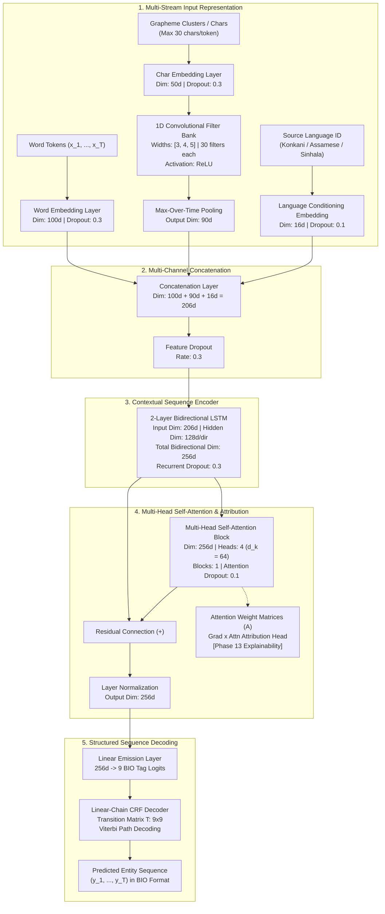

# Neural Architecture Diagram Specification

**Paper Section Target**: Methodology / Architecture Blueprint  
**Reference Configurations**: [`configs/final_konkani.yaml`](file:///c:/Users/harih/Desktop/NLP-MARK-3/configs/final_konkani.yaml), [`configs/final_assamese.yaml`](file:///c:/Users/harih/Desktop/NLP-MARK-3/configs/final_assamese.yaml), [`configs/final_sinhala.yaml`](file:///c:/Users/harih/Desktop/NLP-MARK-3/configs/final_sinhala.yaml)  
**Reference PyTorch Implementation**: [`model/ner_model_v4_multilingual.py`](file:///c:/Users/harih/Desktop/NLP-MARK-3/model/ner_model_v4_multilingual.py)  
**Purpose**: A complete, exact structural specification permitting a graphic artist or vector tool (TikZ/Draw.io/Inkscape) to render an publication-ready system diagram without ambiguity.

---

## 1. High-Level Dataflow Graph (Mermaid)

---

## 2. Granular Layer-by-Layer Dimension Specification

### Module 1: Lexical Word Embedding
- **Input**: Integer token IDs `word_ids` of shape `(Batch, Seq_Len)`.
- **Vocabulary Size**: Unified vocabulary ($89,196$ unique surface words across all 3 languages).
- **Embedding Dimension**: $100$.
- **Padding Index**: $0$ (`<pad>`).
- **Regularization**: Word dropout $p = 0.3$.
- **Output Tensor**: `(Batch, Seq_Len, 100)`.

### Module 2: Character-Level CNN Encoder (`CharCNNWordEncoder`)
- **Input**: Character token IDs `char_ids` of shape `(Batch, Seq_Len, Max_Word_Len)`.
- **Character Vocabulary Size**: $13,022$ Unicode grapheme clusters.
- **Character Embedding Dimension**: $50$.
- **Parallel Convolution Banks**:
  - Filter width $k_1 = 3$, output channels = $30$, padding = $1$.
  - Filter width $k_2 = 4$, output channels = $30$, padding = $2$ (with trailing slice).
  - Filter width $k_3 = 5$, output channels = $30$, padding = $2$.
- **Nonlinearity**: Element-wise $\text{ReLU}$.
- **Temporal Reduction**: 1D Max-over-time pooling across character sequence dimension.
- **Concatenated Char Representation**: $30 + 30 + 30 = 90$ dimensions per word token.
- **Regularization**: Character embedding dropout $p = 0.3$.
- **Output Tensor**: `(Batch, Seq_Len, 90)`.

### Module 3: Language Conditioning Embedding (`LanguageEmbedding`)
- **Input**: Language category ID `lang_ids` $\in \{0: \text{Konkani}, 1: \text{Assamese}, 2: \text{Sinhala}\}$.
- **Number of Languages**: $3$.
- **Embedding Dimension**: $16$.
- **Regularization**: Embedding dropout $p = 0.1$.
- **Broadcast Operation**: Expanded along sequence dimension to shape `(Batch, Seq_Len, 16)`.

### Module 4: Feature Fusion & Channel Dropout
- **Concatenation**: $[ \mathbf{e}_{\text{word}} \,\|\, \mathbf{e}_{\text{char}} \,\|\, \mathbf{e}_{\text{lang}} ]$.
- **Combined Feature Dimension**: $100 + 90 + 16 = 206$.
- **Regularization**: Concat dropout $p = 0.3$.
- **Output Tensor**: `(Batch, Seq_Len, 206)`.

### Module 5: Contextual Sequence Encoder (`BiLSTMEncoder`)
- **Architecture**: 2 stacked Bidirectional LSTM layers.
- **Input Dimension**: $206$.
- **Hidden State Dimension**: $128$ per direction (Forward: $128$, Backward: $128$).
- **Inter-layer Dropout**: $p = 0.3$.
- **Output Tensor**: $\mathbf{H}_{\text{BiLSTM}} \in \mathbb{R}^{\text{Batch} \times \text{Seq\_Len} \times 256}$.

### Module 6: Multi-Head Self-Attention Block (`MultiHeadSelfAttentionBlock`)
- **Input Dimension**: $256$.
- **Number of Attention Heads**: $4$.
- **Head Dimension ($d_k$)**: $256 / 4 = 64$.
- **Number of Attention Blocks**: $1$.
- **Projection Matrices**: $W_Q, W_K, W_V \in \mathbb{R}^{256 \times 256}$.
- **Attention Computation**:
  $$\text{Head}_h = \text{Softmax}\left( \frac{Q_h K_h^T}{\sqrt{64}} + M \right) V_h$$
  where $M_{i, j} = -\infty$ for padded tokens and $0$ otherwise.
- **Attention Dropout**: $p = 0.1$.
- **Residual Connection & Normalization**:
  $$\mathbf{H}_{\text{Attn}} = \text{LayerNorm}\left( \mathbf{H}_{\text{BiLSTM}} + W_O [ \text{Head}_1 \,\|\, \dots \,\|\, \text{Head}_4 ] \right)$$
- **Output Tensor**: `(Batch, Seq_Len, 256)`.

### Module 7: Sequence Decoding Head (`LinearChainCRF`)
- **Linear Emission Projection**: Weight matrix $W_{\text{emiss}} \in \mathbb{R}^{256 \times 9}$, bias $b_{\text{emiss}} \in \mathbb{R}^9$.
- **Emission Tensor**: $\mathbf{E} \in \mathbb{R}^{\text{Batch} \times \text{Seq\_Len} \times 9}$.
- **BIO Tag Vocabulary ($9$ Classes)**:
  - `O` (Index 0)
  - `B-PER` (Index 1), `I-PER` (Index 2)
  - `B-LOC` (Index 3), `I-LOC` (Index 4)
  - `B-ORG` (Index 5), `I-ORG` (Index 6)
  - `B-MISC` (Index 7), `I-MISC` (Index 8)
- **Transition Parameter Matrix**: Learnable transitions $T \in \mathbb{R}^{9 \times 9}$ where $T_{u, v}$ represents score of transitioning from tag $u$ to tag $v$.
- **Inference Decoding**: Exact dynamic programming Viterbi search finding $\arg\max_{\mathbf{y}} \left( \sum_{t=1}^T E_{t, y_t} + \sum_{t=1}^{T-1} T_{y_t, y_{t+1}} \right)$.
- **Training Loss**: Negative sequence log-likelihood: $\mathcal{L} = -\left( \text{Score}(\mathbf{x}, \mathbf{y}^*) - \log \sum_{\mathbf{y}'} \exp(\text{Score}(\mathbf{x}, \mathbf{y}')) \right)$.

---

## 3. Visual Layout Guidelines for Publication Diagrams

When illustrating this architecture for the Springer paper:
1. **Vertical Hierarchy**: Layout should flow from bottom (raw multilingual tokens) to top (CRF predicted BIO tags).
2. **Three Input Streams**: Place Word Embedding (left), Char-CNN (center), and Language Conditioning (right) side-by-side feeding into a horizontal Concatenation bar.
3. **Internal Detail Box for Char-CNN**: Show the 3 parallel convolution kernels ($k=3, 4, 5$) collapsing via max-pooling into a single 90d vector.
4. **Explainability Tap**: Draw a dashed arrow from the Multi-Head Attention attention weight block branching rightward to an "Attribution Engine ($\nabla_\alpha \text{score}$)" callout box to illustrate the interpretability contribution.
