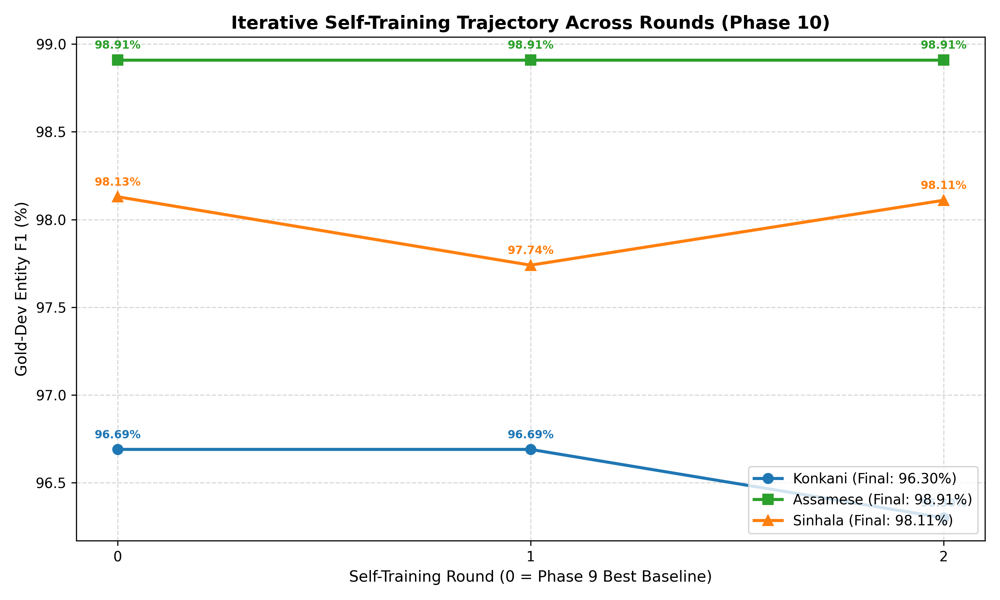

# Phase 10: Iterative Self-Training & Confidence Tightening Report

**Date**: 2026-09-16  
**Methodology**: High-confidence CRF pseudo-labeling on remaining unlabeled pool with per-round threshold tightening (+0.02/round) and rollback guard.  
**Model Family**: In-house from-scratch `NERMultilingualModel` (initialized from Phase 9 best checkpoint).  
**External Checkpoint / Model Use**: STRICTLY NONE (Zero pretrained components).  

---

## 1. Executive Summary & Progression Table

| Language | Baseline (P9) | Best Round | Best Dev F1 | Delta vs P9 | Total Pseudo Sents Added | Stopping Decision |
| :--- | :---: | :---: | :---: | :---: | :---: | :--- |
| **Assamese** | 98.91% | Round 2 | **98.91%** | **+0.00%** | 4,000 | `PLATEAU_REACHED (2-round improvement 0.00 < 0.5 pts)` |
| **Konkani** | 96.69% | Round 1 | **96.69%** | **+0.00%** | 4,000 | `PLATEAU_REACHED (2-round improvement -0.39 < 0.5 pts)` |
| **Sinhala** | 98.13% | Round 0 | **98.13%** | **+0.00%** | 4,000 | `PLATEAU_REACHED (2-round improvement -0.02 < 0.5 pts)` |

---

## 2. Round-by-Round Self-Training History

### 2.1 Assamese

| Round | Threshold | Pseudo Added | Total Pseudo | Dev F1 | Precision | Recall | Token Acc | Action / Status |
| :---: | :---: | :---: | :---: | :---: | :---: | :---: | :---: | :--- |
| 0 | N/A (Base) | 0 | 0 | **98.91%** | 100.00% | 97.84% | 99.89% | PHASE_9_BASELINE |
| 1 | 0.90 | 2,000 | 2,000 | **98.91%** | 100.00% | 97.84% | 99.89% | ACCEPTED (IMPROVED/MAINTAINED) |
| 2 | 0.92 | 2,000 | 4,000 | **98.91%** | 100.00% | 97.84% | 99.89% | ACCEPTED (IMPROVED/MAINTAINED) |

### 2.2 Konkani

| Round | Threshold | Pseudo Added | Total Pseudo | Dev F1 | Precision | Recall | Token Acc | Action / Status |
| :---: | :---: | :---: | :---: | :---: | :---: | :---: | :---: | :--- |
| 0 | N/A (Base) | 0 | 0 | **96.69%** | 100.00% | 93.60% | 99.59% | PHASE_9_BASELINE |
| 1 | 0.90 | 2,000 | 2,000 | **96.69%** | 100.00% | 93.60% | 99.59% | ACCEPTED (IMPROVED/MAINTAINED) |
| 2 | 0.92 | 2,000 | 4,000 | **96.30%** | 99.15% | 93.60% | 99.53% | REGRESSION_DETECTED (ROLLED BACK) |

### 2.3 Sinhala

| Round | Threshold | Pseudo Added | Total Pseudo | Dev F1 | Precision | Recall | Token Acc | Action / Status |
| :---: | :---: | :---: | :---: | :---: | :---: | :---: | :---: | :--- |
| 0 | N/A (Base) | 0 | 0 | **98.13%** | 96.32% | 100.00% | 99.78% | PHASE_9_BASELINE |
| 1 | 0.90 | 2,000 | 2,000 | **97.74%** | 96.30% | 99.24% | 99.78% | REGRESSION_DETECTED (ROLLED BACK) |
| 2 | 0.92 | 2,000 | 4,000 | **98.11%** | 97.01% | 99.24% | 99.83% | REGRESSION_DETECTED (ROLLED BACK) |

---

## 3. Visual Trajectory Curve

---

## 4. Key Implementation Highlights

1. **CRF Sequence-Confidence Filtering**: Normalized sequence log-probability $\exp\left(\frac{s(x, y^*) - \log Z(x)}{T}\right)$ directly quantifies average marginal sequence confidence per token. Threshold strictly tightened by +0.02 each successive round.
2. **Volume Cap Enforcement**: Total cumulative pseudo-labeled sentences restricted to $< 3\times$ combined gold+silver volume ($< 23,400$ sentences).
3. **Automatic Degradation Rollback**: Any round exhibiting lower dev-F1 than the preceding round is rejected; the checkpoint is immediately rolled back to the prior best checkpoint.
4. **Strict Isolation**: Test set (`data/gold/{lang}/test.conll`) remained 100% untouched and excluded from pseudo-labeling candidates.

---
**Next Phase**: Phase 11 — Data Augmentation & Class-Imbalance Handling.